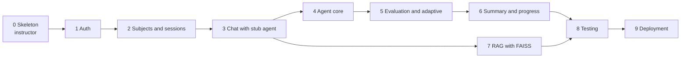

# Socratic Agent: Implementation Guide

This guide tells you how to build the Socratic Agent in phases. It uses the design in the project document (`socratic-agent-docs/`). Section numbers such as "§17.6" refer to that document.

## Who Does What

| Phase | Owner | Goal |
|---|---|---|
| **0** | **Instructor** | Set up the database, create the schema and tables, and build the project skeleton. |
| 1-9 | **Student** | Build the features on top of the skeleton, one phase at a time. |

The student never changes the database schema. The student never rebuilds the skeleton. Each student phase fills in the stubs that Phase 0 leaves.

## Phase Map

| Phase | File | Owner | What is built | Main design sections | Indicative time |
|---|---|---|---|---|---|
| 0 | [phase-0-instructor-skeleton.md](phase-0-instructor-skeleton.md) | Instructor | PostgreSQL, Alembic migration, models, seed data, backend and frontend skeleton, CI, test fixtures, stubs | §5-7, §19, §20, §32 | 2-3 days |
| 1 | [phase-1-authentication.md](phase-1-authentication.md) | Student | Register, login, refresh, JWT, account endpoints, login and registration pages, BFF | §9.1-9.3, §18.3-18.4, §20.3, §26 | 1 week |
| 2 | [phase-2-subjects-and-sessions.md](phase-2-subjects-and-sessions.md) | Student | Subjects and session APIs, dashboard, subject selection, history list | §9.4-9.5, §18.5-18.6 | 1 week |
| 3 | [phase-3-chat-with-stub-agent.md](phase-3-chat-with-stub-agent.md) | Student | Message APIs with the 3-part transaction flow, chat UI, hint button (stub agent) | §8.2, §18.7, §19.5, §21 | 1-1.5 weeks |
| 4 | [phase-4-socratic-agent-core.md](phase-4-socratic-agent-core.md) | Student | Real LLM, prompts, dialogue engine, answer-leak guard, hint ladder, memory | §14, §16 | 1.5-2 weeks |
| 5 | [phase-5-evaluation-and-adaptive.md](phase-5-evaluation-and-adaptive.md) | Student | Evaluator, misconceptions, adaptive controller, level estimator, assessments, goal resolution | §15, §9.8-9.9 | 2 weeks |
| 6 | [phase-6-summary-and-progress.md](phase-6-summary-and-progress.md) | Student | End session, summary, mastery, progress dashboard, history detail, account deletion | §15.6, §18.6, §18.9, §9.13-9.15 | 1 week |
| 7 | [phase-7-rag-faiss.md](phase-7-rag-faiss.md) | Student | Document upload, ingestion, FAISS index, retriever, admin pages | §17, §18.10 | 2 weeks |
| 8 | [phase-8-testing-and-evaluation.md](phase-8-testing-and-evaluation.md) | Student | Coverage, E2E tests, AI evaluation set, security and accessibility checks | §24-26 | 1-2 weeks |
| 9 | [phase-9-deployment.md](phase-9-deployment.md) | Student | Backend service (uv, no Docker), Vercel, Railway or Render, migrations on deploy, smoke test | §28 | 1 week |

Total for the student: about 11-13 weeks. The times are indicative.

**MVP release:** Phases 0 to 6, plus 8 (core tests) and 9, with `RAG_ENABLED=false`. Phase 7 gives Release 1.1 (see §30).

## Phase Dependencies



Phase 7 needs only Phase 3 and Phase 4. A team of two students can build Phase 7 in parallel with Phases 5 and 6.

## The Skeleton Contract

Phase 0 gives the student a repository where:

- The database schema exists and matches §7.1 exactly. The student does not change it.
- The Pydantic schemas (the API contract, §18.12) are complete.
- The agent data contracts (`AgentState`, `EvaluationResult`, `TutorReply`, and others) and a `FakeGateway` are complete.
- Every unfinished function raises `NotImplementedError("TODO(phase-N): ...")`. The API returns `501 NOT_IMPLEMENTED` for it.
- Every unfinished page shows a "TODO phase N" placeholder.

**Find your work list:** run `grep -rn "TODO(phase-3)" backend frontend`. Each result is one task of that phase.

## Working Rules for Students

1. **One branch for each phase:** `phase-N/<your-name>`. Open a pull request into `main` when the phase is done. The instructor reviews and merges it.
2. **Small commits.** One logical change in each commit, with a short imperative message ("Add login endpoint").
3. **Follow the layers** (§19.2): routers call services. Services own the database and transactions. The agent never imports SQLAlchemy.
4. **Call the LLM only through `LLMGateway`.**
5. **Write tests with the code.** A phase is not done without its tests.
6. **Do not change the schema.** If you find a schema problem, tell the instructor. The instructor adds a migration.
7. **Do not change the Pydantic schemas** without instructor approval. They are the contract between frontend and backend.
8. **Never commit secrets.** Only `.env.example` goes into Git.
9. **Do not copy the reference code blindly.** The design document has reference code for some parts. Read the rules first, write your own version, and then compare.
10. **Ask early.** If you are blocked for more than 2 hours, ask.

## Definition of Done (Every Phase)

- [ ] All `TODO(phase-N)` markers of the phase are removed.
- [ ] The phase tests pass: `pytest tests/phase_N -q` (and `npm test` for frontend phases).
- [ ] The full test suite passes (nothing from earlier phases is broken).
- [ ] `ruff check .`, `eslint` and `tsc --noEmit` show no errors.
- [ ] `alembic check` shows no differences.
- [ ] The demo in the phase file works on a clean clone.
- [ ] The pull request has a short description and the filled checklist.

## Review Rubric (Per Phase)

| Criterion | Weight | Check |
|---|---|---|
| Correct behavior | 40% | Acceptance criteria and phase tests pass. |
| Design rules | 20% | Layers, one transaction for each turn, LLM only through the gateway, no secrets. |
| Tests | 20% | Phase tests exist and test real behavior, including error cases. |
| Code quality | 10% | Types, names, no dead code, lint clean. |
| Communication | 10% | Clear pull request and commit messages. |

## Pull Request Template (Put in `.github/pull_request_template.md`)

```markdown
## Phase
Phase N: <name>

## What I built
- ...

## How to test
1. ...

## Checklist
- [ ] TODO(phase-N) markers removed
- [ ] Phase tests pass
- [ ] Full test suite passes
- [ ] Lint and type checks pass
- [ ] No schema or contract changes (or approved by the instructor)
- [ ] No secrets in the commit
```
