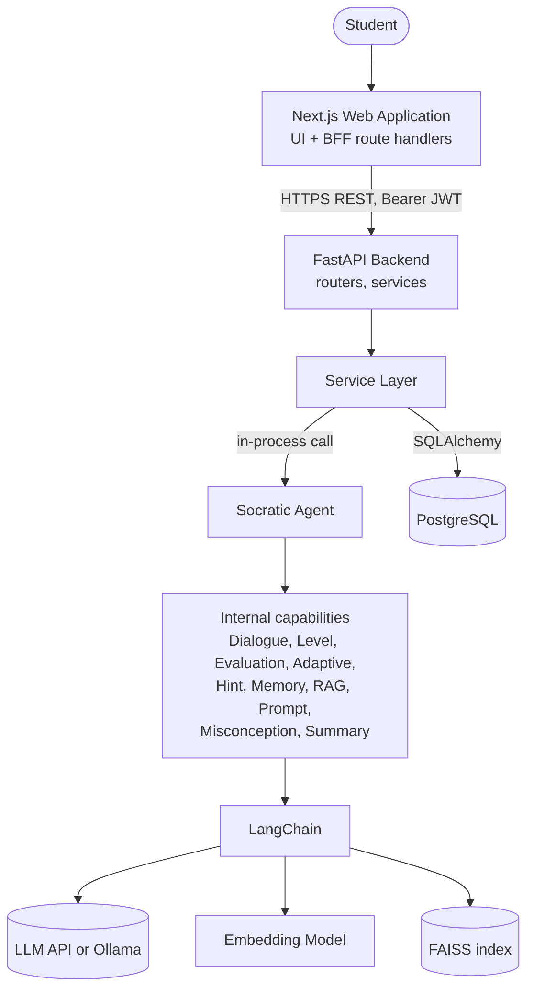

# Architecture and AI Interaction Flow

*Socratic Agent project document. [Index](README.md) | [← Previous](01-overview-and-stack.md) | [Next →](03-database-design.md)*

---

## 3. Core System Architecture

### 3.1 Architecture Principle

The system uses **one Socratic Agent**. The agent is one Python component with ten internal capabilities. The capabilities are modules, not independent agents. They do not have their own goals, memory or LLM loops.

### 3.2 High-Level Architecture

```text
Student
   |
   v
Next.js Web Application
   |
   v
FastAPI Backend
   |
   v
Socratic Agent
   |
   +---- Learner Analysis
   +---- Response Evaluation
   +---- Adaptive Learning
   +---- Socratic Question Generation
   +---- RAG Retrieval
   |
   v
LangChain
   |
   +---- LLM
   +---- Embedding Model
   +---- Vector Store
   |
   +---- FAISS index
   |
   v
PostgreSQL
```



### 3.3 Component Responsibilities

| Component | Responsibility | Talks to | Protocol |
|---|---|---|---|
| Student (browser) | Reads questions, types answers. | Next.js | HTTPS |
| Next.js application | Shows pages. Stores tokens in httpOnly cookies. Forwards API calls (BFF). | FastAPI | HTTPS, JSON |
| FastAPI backend | Validates input. Authenticates users. Routes requests. Returns JSON. | Service layer | Python calls |
| Service layer | Runs business rules. Opens database transactions. Calls the agent. | PostgreSQL, Agent, RAG | SQLAlchemy, Python calls |
| Socratic Agent | Runs one tutoring turn. Evaluates the answer. Updates the agent state. Creates the next question or hint. | LangChain (through the gateway), retriever | Python calls |
| LangChain | Gives one interface to chat models, embeddings and vector stores. | LLM API, embedding model, vector store | HTTPS, in-process |
| LLM | Generates text and structured evaluation data. | - | HTTPS |
| Embedding model | Converts text to vectors. | - | In-process |
| Vector store (FAISS) | Stores vectors. Finds the IDs of similar chunks. | - | In-process (index file on a volume) |
| PostgreSQL | Stores users, sessions, messages, assessments, progress and document metadata. | - | TCP (TLS) |

### 3.4 Design Rules

| ID | Rule |
|---|---|
| R-01 | The system must have one agent. |
| R-02 | The agent must not access the database. It receives input data and returns output data. |
| R-03 | The service layer must save the result of a turn in **one** database transaction. |
| R-04 | The system must not keep a database transaction open during an LLM call. |
| R-05 | PostgreSQL is the source of truth. The vector store is a search index that the system can rebuild. |
| R-06 | The system must treat student text and retrieved text as untrusted data (see Section 26). |
| R-07 | The system must call the LLM through the `LLMGateway` interface only. |

### 3.5 The Ten Internal Capabilities

| # | Capability | Module (`app/agents/capabilities/`) | Uses LLM? | Task |
|---|---|---|---|---|
| 1 | Socratic Dialogue Engine | `dialogue_engine.py` | Yes (reply) | Runs the turn. Selects question, hint or closing message. Applies the answer-leak guard. |
| 2 | Learner Level Estimation | `level_estimator.py` | No | Updates `level_score` and `current_level`. |
| 3 | Response Evaluation | `response_evaluator.py` | Yes (evaluation) | Scores correctness, reasoning and confidence. |
| 4 | Adaptive Learning | `adaptive_controller.py` | No | Changes difficulty and hint level with fixed rules. |
| 5 | Hint Generation | `hint_generator.py` | No (prompt block) | Selects the hint instruction for the current hint level. |
| 6 | Conversation Memory | `conversation_memory.py` | Optional | Selects recent messages. Keeps a rolling summary. |
| 7 | RAG Retrieval | `knowledge_retriever.py` | No | Finds relevant chunks for the current goal. |
| 8 | Prompt Construction | `prompt_builder.py` | No | Builds the LLM messages from templates. |
| 9 | Misconception Detection | `misconception_detector.py` | No (uses evaluation output) | Normalizes labels. Counts repeated misconceptions. |
| 10 | Session Summary Generation | `session_summarizer.py` | Yes (summary) | Creates the end-of-session summary. |

One student turn uses **two LLM calls**: one for evaluation and one for the tutor reply. The session end uses one more call for the summary.

---

## 4. AI Interaction Flow

### 4.1 Complete Flow

```text
Student enters question
        ↓
FastAPI receives request
        ↓
Load conversation and learner state
        ↓
Analyze student input
        ↓
Estimate learner level
        ↓
Retrieve relevant educational material
        ↓
Construct Socratic prompt
        ↓
LLM generates guiding question or hint
        ↓
Student responds
        ↓
Evaluate response
        ↓
Detect correctness, reasoning quality and misconceptions
        ↓
Update learner state
        ↓
Adjust difficulty and guidance
        ↓
Continue Socratic dialogue
        ↓
Student reaches correct reasoning
        ↓
Generate session summary
        ↓
Store progress in PostgreSQL
```

### 4.2 Implementation View

The flow has two parts. The service function `handle_student_message` runs both parts for each request.

- **Part A - First turn:** stages 1 to 8. The student's first message is the question. There is nothing to evaluate.
- **Part B - Later turns:** stages 9 to 14. The agent evaluates the answer to the previous agent question. Then it runs stages 6 to 8 again to create the next question or hint.
- **Part C - Completion:** stages 15 and 16.

| # | Stage | Component | Reads | Writes | LLM call |
|---|---|---|---|---|---|
| 1 | Student enters question | Chat UI | - | - | - |
| 2 | FastAPI receives request | Router, auth dependency | `users` | - | - |
| 3 | Load conversation and learner state | `MessageService` | `learning_sessions`, `messages`, `learner_profiles` | - | - |
| 4 | Analyze student input | Dialogue engine | - | - | - |
| 5 | Estimate learner level | Level estimator | (state from stage 3) | - | - |
| 6 | Retrieve educational material | RAG retriever | Vector store | - | - |
| 7 | Construct Socratic prompt | Prompt builder | - | - | - |
| 8 | LLM generates guiding question or hint | Dialogue engine | - | - | Yes |
| 9 | Student responds | Chat UI | - | - | - |
| 10 | Evaluate response | Response evaluator | - | - | Yes |
| 11 | Detect correctness, reasoning, misconceptions | Evaluator, misconception detector | - | - | - |
| 12 | Update learner state | Level estimator, `MessageService` | - | `learner_profiles`, `learning_sessions.agent_state` | - |
| 13 | Adjust difficulty and guidance | Adaptive controller | - | `learning_sessions.agent_state` | - |
| 14 | Continue Socratic dialogue | Dialogue engine | - | `messages`, `learner_assessments` | Yes |
| 15 | Generate session summary | Session summarizer | `messages`, `learner_assessments` | - | Yes |
| 16 | Store progress | `SessionService`, `ProgressService` | - | `learning_sessions`, `messages`, `learning_progress`, `learner_profiles` | - |

### 4.3 Stage Explanations

**Stage 1 - Student enters question.** The student types a question or a learning goal in the chat box. The first message of a session sets the **core question** of the session. The UI sends the text to the BFF.

**Stage 2 - FastAPI receives request.** The router checks the JWT. It checks that the session belongs to the user and that the session is `active`. Pydantic validates the body (1 to 4000 characters). The rate limiter checks the request count.

**Stage 3 - Load conversation and learner state.** `MessageService` reads the session row (including `agent_state`), the last messages, the learner profile and the subject. It then closes the database transaction. The system must not hold a connection during the LLM calls.

**Stage 4 - Analyze student input.** The dialogue engine reads the student message. On the first turn, it sets `core_question`. On later turns, it marks the message as the answer to the last agent question. The engine also checks for an explicit hint request.

**Stage 5 - Estimate learner level.** The level estimator reads `current_level` and `level_score` from the profile. On the first turn, it sets the starting difficulty from the level (beginner = 2, intermediate = 3, advanced = 4).

**Stage 6 - Retrieve relevant educational material.** If `RAG_ENABLED` is true, the retriever builds a query from the core question and the latest student message. It searches the FAISS index of the session's subject and reads the chunk text from PostgreSQL. It returns up to `RAG_TOP_K` chunks above the minimum score. If no chunk matches, the agent works in *general knowledge mode* (see Section 17.7).

**Stage 7 - Construct Socratic prompt.** The prompt builder combines the system instructions, learner context, subject context, memory, retrieved chunks, current student message and output rules (Section 16).

**Stage 8 - LLM generates guiding question or hint.** The LLM returns a structured `TutorReply`. The answer-leak guard checks it. If the guard finds a violation, the engine asks the LLM one more time. If the second reply also fails, the engine uses a safe template question.

**Stage 9 - Student responds.** The student types an answer. The UI sends it to the same message endpoint. The first message type is `question`. Later student messages are `response`.

**Stage 10 - Evaluate response.** The evaluator calls the LLM with the core question, the last agent question, the student answer and the retrieved reference text. The LLM returns a structured `EvaluationResult`.

**Stage 11 - Detect correctness, reasoning quality and misconceptions.** The `EvaluationResult` has `correctness_score`, `reasoning_score`, `confidence_score`, `misconception`, `addresses_core_question` and `requests_hint`. The misconception detector normalizes the label and counts repeats.

**Stage 12 - Update learner state.** The level estimator updates `level_score` and `assessment_count`. It can change `current_level`. The service layer saves the update.

**Stage 13 - Adjust difficulty and guidance.** The adaptive controller applies the rules in Section 15. It changes the difficulty (1 to 5) and the hint level (0 to 3). It checks if the student has reached the goal (`resolved`).

**Stage 14 - Continue Socratic dialogue.** If the goal is not reached, the agent runs stages 6 to 8 with the new state. The service layer then writes the student message, the assessment and the agent message in one transaction.

**Stage 15 - Generate session summary.** When the student ends the session, the summarizer creates a structured summary: concepts learned, strengths, misconceptions that were corrected, areas to review and next steps. If the LLM fails, the system builds a fallback summary from stored data.

**Stage 16 - Store progress in PostgreSQL.** The service layer sets the session status, `ended_at` and `summary`. It adds the summary message. It updates `learning_progress` (mastery) and the learner profile (strengths, weaknesses). All writes use one transaction.

---

*[Index](README.md) | [← Previous](01-overview-and-stack.md) | [Next →](03-database-design.md)*
