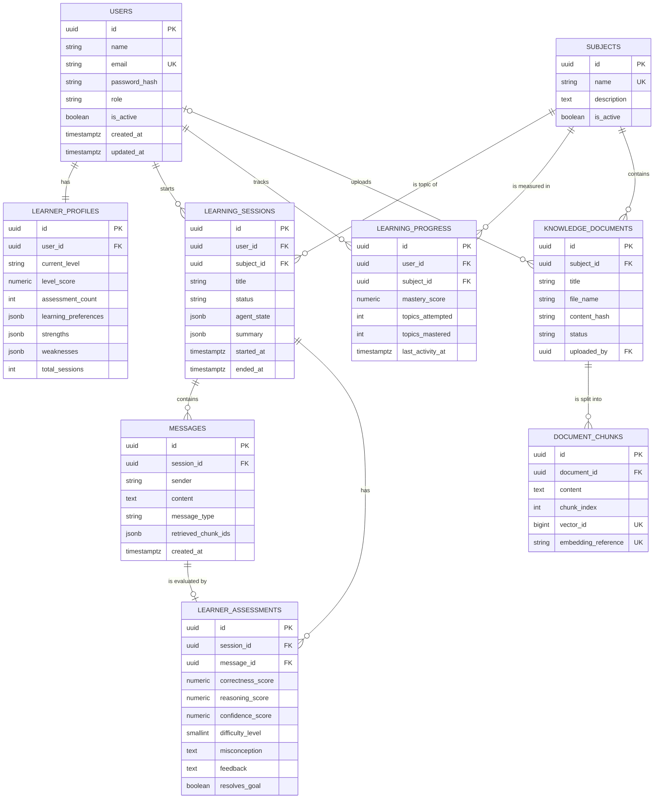

# Database Schema: SQL, ORM Models and ER Diagram

*Socratic Agent project document. [Index](README.md) | [← Previous](03-database-design.md) | [Next →](05-requirements.md)*

---

## 7. Database Schema Output

### 7.1 PostgreSQL `CREATE TABLE` Statements

The statements are the same as the Alembic initial migration. Constraint names match the SQLAlchemy naming convention in Section 7.2.

```sql
-- 0001_initial_schema.sql  (PostgreSQL 15+)

CREATE TABLE users (
    id             UUID         NOT NULL DEFAULT gen_random_uuid(),
    name           VARCHAR(120) NOT NULL,
    email          VARCHAR(255) NOT NULL,
    password_hash  VARCHAR(255) NOT NULL,
    role           VARCHAR(20)  NOT NULL DEFAULT 'student',
    is_active      BOOLEAN      NOT NULL DEFAULT TRUE,
    created_at     TIMESTAMPTZ  NOT NULL DEFAULT now(),
    updated_at     TIMESTAMPTZ  NOT NULL DEFAULT now(),
    CONSTRAINT pk_users PRIMARY KEY (id),
    CONSTRAINT uq_users_email UNIQUE (email),
    CONSTRAINT ck_users_role_valid CHECK (role IN ('student', 'admin')),
    CONSTRAINT ck_users_email_lowercase CHECK (email = lower(email))
);

CREATE TABLE learner_profiles (
    id                    UUID          NOT NULL DEFAULT gen_random_uuid(),
    user_id               UUID          NOT NULL,
    current_level         VARCHAR(20)   NOT NULL DEFAULT 'beginner',
    level_score           NUMERIC(4,3)  NOT NULL DEFAULT 0.300,
    assessment_count      INTEGER       NOT NULL DEFAULT 0,
    learning_preferences  JSONB         NOT NULL DEFAULT '{}'::jsonb,
    strengths             JSONB         NOT NULL DEFAULT '[]'::jsonb,
    weaknesses            JSONB         NOT NULL DEFAULT '[]'::jsonb,
    total_sessions        INTEGER       NOT NULL DEFAULT 0,
    created_at            TIMESTAMPTZ   NOT NULL DEFAULT now(),
    updated_at            TIMESTAMPTZ   NOT NULL DEFAULT now(),
    CONSTRAINT pk_learner_profiles PRIMARY KEY (id),
    CONSTRAINT uq_learner_profiles_user_id UNIQUE (user_id),
    CONSTRAINT fk_learner_profiles_user_id_users
        FOREIGN KEY (user_id) REFERENCES users (id) ON DELETE CASCADE,
    CONSTRAINT ck_learner_profiles_level_valid
        CHECK (current_level IN ('beginner', 'intermediate', 'advanced')),
    CONSTRAINT ck_learner_profiles_level_score_range CHECK (level_score BETWEEN 0 AND 1),
    CONSTRAINT ck_learner_profiles_counts_nonnegative
        CHECK (assessment_count >= 0 AND total_sessions >= 0)
);

CREATE TABLE subjects (
    id           UUID         NOT NULL DEFAULT gen_random_uuid(),
    name         VARCHAR(120) NOT NULL,
    description  TEXT,
    is_active    BOOLEAN      NOT NULL DEFAULT TRUE,
    created_at   TIMESTAMPTZ  NOT NULL DEFAULT now(),
    CONSTRAINT pk_subjects PRIMARY KEY (id),
    CONSTRAINT uq_subjects_name UNIQUE (name)
);

CREATE TABLE learning_sessions (
    id          UUID         NOT NULL DEFAULT gen_random_uuid(),
    user_id     UUID         NOT NULL,
    subject_id  UUID         NOT NULL,
    title       VARCHAR(255) NOT NULL DEFAULT 'New session',
    status      VARCHAR(20)  NOT NULL DEFAULT 'active',
    agent_state JSONB        NOT NULL DEFAULT '{}'::jsonb,
    summary     JSONB,
    started_at  TIMESTAMPTZ  NOT NULL DEFAULT now(),
    ended_at    TIMESTAMPTZ,
    created_at  TIMESTAMPTZ  NOT NULL DEFAULT now(),
    CONSTRAINT pk_learning_sessions PRIMARY KEY (id),
    CONSTRAINT fk_learning_sessions_user_id_users
        FOREIGN KEY (user_id) REFERENCES users (id) ON DELETE CASCADE,
    CONSTRAINT fk_learning_sessions_subject_id_subjects
        FOREIGN KEY (subject_id) REFERENCES subjects (id) ON DELETE RESTRICT,
    CONSTRAINT ck_learning_sessions_status_valid
        CHECK (status IN ('active', 'completed', 'abandoned')),
    CONSTRAINT ck_learning_sessions_ended_matches_status
        CHECK ((status = 'active') = (ended_at IS NULL)),
    CONSTRAINT ck_learning_sessions_ended_after_start
        CHECK (ended_at IS NULL OR ended_at >= started_at)
);

CREATE TABLE messages (
    id                   UUID        NOT NULL DEFAULT gen_random_uuid(),
    session_id           UUID        NOT NULL,
    sender               VARCHAR(10) NOT NULL,
    content              TEXT        NOT NULL,
    message_type         VARCHAR(20) NOT NULL,
    retrieved_chunk_ids  JSONB       NOT NULL DEFAULT '[]'::jsonb,
    created_at           TIMESTAMPTZ NOT NULL DEFAULT now(),
    CONSTRAINT pk_messages PRIMARY KEY (id),
    CONSTRAINT fk_messages_session_id_learning_sessions
        FOREIGN KEY (session_id) REFERENCES learning_sessions (id) ON DELETE CASCADE,
    CONSTRAINT ck_messages_sender_valid CHECK (sender IN ('student', 'agent', 'system')),
    CONSTRAINT ck_messages_type_valid
        CHECK (message_type IN ('question', 'response', 'guidance', 'hint', 'summary', 'system')),
    CONSTRAINT ck_messages_content_not_empty CHECK (char_length(content) > 0),
    CONSTRAINT ck_messages_sender_type_consistent CHECK (
        (sender = 'student' AND message_type IN ('question', 'response')) OR
        (sender = 'agent'   AND message_type IN ('guidance', 'hint', 'summary')) OR
        (sender = 'system'  AND message_type = 'system')
    )
);

CREATE TABLE learner_assessments (
    id                 UUID         NOT NULL DEFAULT gen_random_uuid(),
    session_id         UUID         NOT NULL,
    message_id         UUID         NOT NULL,
    correctness_score  NUMERIC(4,3) NOT NULL,
    reasoning_score    NUMERIC(4,3) NOT NULL,
    confidence_score   NUMERIC(4,3) NOT NULL,
    difficulty_level   SMALLINT     NOT NULL,
    misconception      TEXT,
    feedback           TEXT,
    resolves_goal      BOOLEAN      NOT NULL DEFAULT FALSE,
    created_at         TIMESTAMPTZ  NOT NULL DEFAULT now(),
    CONSTRAINT pk_learner_assessments PRIMARY KEY (id),
    CONSTRAINT uq_learner_assessments_message_id UNIQUE (message_id),
    CONSTRAINT fk_learner_assessments_session_id_learning_sessions
        FOREIGN KEY (session_id) REFERENCES learning_sessions (id) ON DELETE CASCADE,
    CONSTRAINT fk_learner_assessments_message_id_messages
        FOREIGN KEY (message_id) REFERENCES messages (id) ON DELETE CASCADE,
    CONSTRAINT ck_learner_assessments_correctness_range CHECK (correctness_score BETWEEN 0 AND 1),
    CONSTRAINT ck_learner_assessments_reasoning_range CHECK (reasoning_score BETWEEN 0 AND 1),
    CONSTRAINT ck_learner_assessments_confidence_range CHECK (confidence_score BETWEEN 0 AND 1),
    CONSTRAINT ck_learner_assessments_difficulty_range CHECK (difficulty_level BETWEEN 1 AND 5)
);

CREATE TABLE learning_progress (
    id                UUID         NOT NULL DEFAULT gen_random_uuid(),
    user_id           UUID         NOT NULL,
    subject_id        UUID         NOT NULL,
    mastery_score     NUMERIC(4,3) NOT NULL DEFAULT 0,
    topics_attempted  INTEGER      NOT NULL DEFAULT 0,
    topics_mastered   INTEGER      NOT NULL DEFAULT 0,
    last_activity_at  TIMESTAMPTZ,
    created_at        TIMESTAMPTZ  NOT NULL DEFAULT now(),
    updated_at        TIMESTAMPTZ  NOT NULL DEFAULT now(),
    CONSTRAINT pk_learning_progress PRIMARY KEY (id),
    CONSTRAINT uq_learning_progress_user_id_subject_id UNIQUE (user_id, subject_id),
    CONSTRAINT fk_learning_progress_user_id_users
        FOREIGN KEY (user_id) REFERENCES users (id) ON DELETE CASCADE,
    CONSTRAINT fk_learning_progress_subject_id_subjects
        FOREIGN KEY (subject_id) REFERENCES subjects (id) ON DELETE CASCADE,
    CONSTRAINT ck_learning_progress_mastery_range CHECK (mastery_score BETWEEN 0 AND 1),
    CONSTRAINT ck_learning_progress_topics_valid
        CHECK (topics_attempted >= 0 AND topics_mastered >= 0
               AND topics_mastered <= topics_attempted)
);

CREATE TABLE knowledge_documents (
    id             UUID         NOT NULL DEFAULT gen_random_uuid(),
    subject_id     UUID         NOT NULL,
    title          VARCHAR(255) NOT NULL,
    description    TEXT,
    file_name      VARCHAR(255) NOT NULL,
    source         VARCHAR(500),
    content_hash   CHAR(64)     NOT NULL,
    status         VARCHAR(20)  NOT NULL DEFAULT 'pending',
    error_message  TEXT,
    uploaded_by    UUID,
    created_at     TIMESTAMPTZ  NOT NULL DEFAULT now(),
    CONSTRAINT pk_knowledge_documents PRIMARY KEY (id),
    CONSTRAINT uq_knowledge_documents_subject_id_content_hash UNIQUE (subject_id, content_hash),
    CONSTRAINT fk_knowledge_documents_subject_id_subjects
        FOREIGN KEY (subject_id) REFERENCES subjects (id) ON DELETE RESTRICT,
    CONSTRAINT fk_knowledge_documents_uploaded_by_users
        FOREIGN KEY (uploaded_by) REFERENCES users (id) ON DELETE SET NULL,
    CONSTRAINT ck_knowledge_documents_status_valid
        CHECK (status IN ('pending', 'processing', 'indexed', 'failed'))
);

CREATE TABLE document_chunks (
    id                   UUID         NOT NULL DEFAULT gen_random_uuid(),
    vector_id            BIGINT       GENERATED ALWAYS AS IDENTITY NOT NULL,
    document_id          UUID         NOT NULL,
    content              TEXT         NOT NULL,
    chunk_index          INTEGER      NOT NULL,
    embedding_reference  VARCHAR(100),
    created_at           TIMESTAMPTZ  NOT NULL DEFAULT now(),
    CONSTRAINT pk_document_chunks PRIMARY KEY (id),
    CONSTRAINT uq_document_chunks_document_id_chunk_index UNIQUE (document_id, chunk_index),
    CONSTRAINT uq_document_chunks_vector_id UNIQUE (vector_id),
    CONSTRAINT uq_document_chunks_embedding_reference UNIQUE (embedding_reference),
    CONSTRAINT fk_document_chunks_document_id_knowledge_documents
        FOREIGN KEY (document_id) REFERENCES knowledge_documents (id) ON DELETE CASCADE,
    CONSTRAINT ck_document_chunks_index_nonnegative CHECK (chunk_index >= 0)
);

-- Indexes (primary keys and unique constraints already create indexes)
CREATE INDEX ix_learning_sessions_user_id_started_at ON learning_sessions (user_id, started_at DESC);
CREATE INDEX ix_learning_sessions_user_id_status     ON learning_sessions (user_id, status);
CREATE INDEX ix_learning_sessions_subject_id         ON learning_sessions (subject_id);
CREATE INDEX ix_messages_session_id_created_at       ON messages (session_id, created_at);
CREATE INDEX ix_learner_assessments_session_id_created_at
    ON learner_assessments (session_id, created_at);
CREATE INDEX ix_learning_progress_subject_id         ON learning_progress (subject_id);
CREATE INDEX ix_knowledge_documents_subject_id_status ON knowledge_documents (subject_id, status);

-- updated_at triggers (protect direct SQL updates; the ORM also sets updated_at)
CREATE OR REPLACE FUNCTION set_updated_at() RETURNS trigger AS $$
BEGIN
    NEW.updated_at = now();
    RETURN NEW;
END;
$$ LANGUAGE plpgsql;

CREATE TRIGGER trg_users_updated_at BEFORE UPDATE ON users
    FOR EACH ROW EXECUTE FUNCTION set_updated_at();
CREATE TRIGGER trg_learner_profiles_updated_at BEFORE UPDATE ON learner_profiles
    FOR EACH ROW EXECUTE FUNCTION set_updated_at();
CREATE TRIGGER trg_learning_progress_updated_at BEFORE UPDATE ON learning_progress
    FOR EACH ROW EXECUTE FUNCTION set_updated_at();
```

### 7.2 SQLAlchemy ORM Models

The code below shows all model files together. Put each model in its own file under `app/models/` (see Section 19).

```python
# app/database/base.py
import uuid
from datetime import datetime

from sqlalchemy import MetaData, text
from sqlalchemy.dialects.postgresql import TIMESTAMP, UUID
from sqlalchemy.orm import DeclarativeBase, Mapped, mapped_column

NAMING_CONVENTION = {
    "ix": "ix_%(column_0_label)s",
    "uq": "uq_%(table_name)s_%(column_0_N_name)s",
    "ck": "ck_%(table_name)s_%(constraint_name)s",   # CHECK names are given as short names
    "fk": "fk_%(table_name)s_%(column_0_name)s_%(referred_table_name)s",
    "pk": "pk_%(table_name)s",
}


class Base(DeclarativeBase):
    metadata = MetaData(naming_convention=NAMING_CONVENTION)
    type_annotation_map = {
        uuid.UUID: UUID(as_uuid=True),
        datetime: TIMESTAMP(timezone=True),
    }


class UUIDPrimaryKeyMixin:
    id: Mapped[uuid.UUID] = mapped_column(
        primary_key=True, default=uuid.uuid4, server_default=text("gen_random_uuid()")
    )


class CreatedAtMixin:
    created_at: Mapped[datetime] = mapped_column(server_default=text("now()"))


class TimestampMixin(CreatedAtMixin):
    updated_at: Mapped[datetime] = mapped_column(
        server_default=text("now()"), onupdate=text("now()")
    )
```

```python
# app/models/enums.py
from enum import StrEnum


class UserRole(StrEnum):
    STUDENT = "student"
    ADMIN = "admin"


class LearnerLevel(StrEnum):
    BEGINNER = "beginner"
    INTERMEDIATE = "intermediate"
    ADVANCED = "advanced"


class SessionStatus(StrEnum):
    ACTIVE = "active"
    COMPLETED = "completed"
    ABANDONED = "abandoned"


class MessageSender(StrEnum):
    STUDENT = "student"
    AGENT = "agent"
    SYSTEM = "system"


class MessageType(StrEnum):
    QUESTION = "question"
    RESPONSE = "response"
    GUIDANCE = "guidance"
    HINT = "hint"
    SUMMARY = "summary"
    SYSTEM = "system"


class DocumentStatus(StrEnum):
    PENDING = "pending"
    PROCESSING = "processing"
    INDEXED = "indexed"
    FAILED = "failed"
```

```python
# app/models/user.py
from sqlalchemy import CheckConstraint, String, text
from sqlalchemy.orm import Mapped, mapped_column, relationship

from app.database.base import Base, TimestampMixin, UUIDPrimaryKeyMixin


class User(UUIDPrimaryKeyMixin, TimestampMixin, Base):
    __tablename__ = "users"
    __table_args__ = (
        CheckConstraint("role IN ('student', 'admin')", name="role_valid"),
        CheckConstraint("email = lower(email)", name="email_lowercase"),
    )

    name: Mapped[str] = mapped_column(String(120))
    email: Mapped[str] = mapped_column(String(255), unique=True)
    password_hash: Mapped[str] = mapped_column(String(255))
    role: Mapped[str] = mapped_column(String(20), default="student", server_default="student")
    is_active: Mapped[bool] = mapped_column(default=True, server_default=text("true"))

    profile: Mapped["LearnerProfile"] = relationship(
        back_populates="user", uselist=False, cascade="all, delete-orphan", passive_deletes=True
    )
    sessions: Mapped[list["LearningSession"]] = relationship(
        back_populates="user", cascade="all, delete-orphan", passive_deletes=True
    )
    progress: Mapped[list["LearningProgress"]] = relationship(
        back_populates="user", cascade="all, delete-orphan", passive_deletes=True
    )
```

```python
# app/models/learner_profile.py
import uuid

from sqlalchemy import CheckConstraint, ForeignKey, Numeric, text
from sqlalchemy.dialects.postgresql import JSONB
from sqlalchemy.orm import Mapped, mapped_column, relationship

from app.database.base import Base, TimestampMixin, UUIDPrimaryKeyMixin


class LearnerProfile(UUIDPrimaryKeyMixin, TimestampMixin, Base):
    __tablename__ = "learner_profiles"
    __table_args__ = (
        CheckConstraint(
            "current_level IN ('beginner', 'intermediate', 'advanced')", name="level_valid"
        ),
        CheckConstraint("level_score BETWEEN 0 AND 1", name="level_score_range"),
        CheckConstraint("assessment_count >= 0 AND total_sessions >= 0", name="counts_nonnegative"),
    )

    user_id: Mapped[uuid.UUID] = mapped_column(
        ForeignKey("users.id", ondelete="CASCADE"), unique=True
    )
    current_level: Mapped[str] = mapped_column(default="beginner", server_default="beginner")
    level_score: Mapped[float] = mapped_column(
        Numeric(4, 3, asdecimal=False), default=0.3, server_default=text("0.300")
    )
    assessment_count: Mapped[int] = mapped_column(default=0, server_default=text("0"))
    learning_preferences: Mapped[dict] = mapped_column(
        JSONB, default=dict, server_default=text("'{}'::jsonb")
    )
    strengths: Mapped[list] = mapped_column(JSONB, default=list, server_default=text("'[]'::jsonb"))
    weaknesses: Mapped[list] = mapped_column(JSONB, default=list, server_default=text("'[]'::jsonb"))
    total_sessions: Mapped[int] = mapped_column(default=0, server_default=text("0"))

    user: Mapped["User"] = relationship(back_populates="profile")
```

```python
# app/models/subject.py
from sqlalchemy import String, Text, text
from sqlalchemy.orm import Mapped, mapped_column, relationship

from app.database.base import Base, CreatedAtMixin, UUIDPrimaryKeyMixin


class Subject(UUIDPrimaryKeyMixin, CreatedAtMixin, Base):
    __tablename__ = "subjects"

    name: Mapped[str] = mapped_column(String(120), unique=True)
    description: Mapped[str | None] = mapped_column(Text)
    is_active: Mapped[bool] = mapped_column(default=True, server_default=text("true"))

    sessions: Mapped[list["LearningSession"]] = relationship(back_populates="subject")
    progress: Mapped[list["LearningProgress"]] = relationship(
        back_populates="subject", cascade="all, delete-orphan", passive_deletes=True
    )
    documents: Mapped[list["KnowledgeDocument"]] = relationship(back_populates="subject")
```

```python
# app/models/learning_session.py
import uuid
from datetime import datetime

from sqlalchemy import CheckConstraint, ForeignKey, Index, String, text
from sqlalchemy.dialects.postgresql import JSONB
from sqlalchemy.orm import Mapped, mapped_column, relationship

from app.database.base import Base, CreatedAtMixin, UUIDPrimaryKeyMixin


class LearningSession(UUIDPrimaryKeyMixin, CreatedAtMixin, Base):
    __tablename__ = "learning_sessions"
    __table_args__ = (
        CheckConstraint("status IN ('active', 'completed', 'abandoned')", name="status_valid"),
        CheckConstraint("(status = 'active') = (ended_at IS NULL)", name="ended_matches_status"),
        CheckConstraint("ended_at IS NULL OR ended_at >= started_at", name="ended_after_start"),
        Index("ix_learning_sessions_user_id_started_at", "user_id", text("started_at DESC")),
        Index("ix_learning_sessions_user_id_status", "user_id", "status"),
        Index("ix_learning_sessions_subject_id", "subject_id"),
    )

    user_id: Mapped[uuid.UUID] = mapped_column(ForeignKey("users.id", ondelete="CASCADE"))
    subject_id: Mapped[uuid.UUID] = mapped_column(ForeignKey("subjects.id", ondelete="RESTRICT"))
    title: Mapped[str] = mapped_column(String(255), default="New session", server_default="New session")
    status: Mapped[str] = mapped_column(String(20), default="active", server_default="active")
    agent_state: Mapped[dict] = mapped_column(JSONB, default=dict, server_default=text("'{}'::jsonb"))
    summary: Mapped[dict | None] = mapped_column(JSONB)
    started_at: Mapped[datetime] = mapped_column(server_default=text("now()"))
    ended_at: Mapped[datetime | None] = mapped_column()

    user: Mapped["User"] = relationship(back_populates="sessions")
    subject: Mapped["Subject"] = relationship(back_populates="sessions")
    messages: Mapped[list["Message"]] = relationship(
        back_populates="session", cascade="all, delete-orphan", passive_deletes=True,
        order_by="Message.created_at",
    )
    assessments: Mapped[list["LearnerAssessment"]] = relationship(
        back_populates="session", cascade="all, delete-orphan", passive_deletes=True,
        order_by="LearnerAssessment.created_at",
    )
```

```python
# app/models/message.py
import uuid

from sqlalchemy import CheckConstraint, ForeignKey, Index, String, Text, text
from sqlalchemy.dialects.postgresql import JSONB
from sqlalchemy.orm import Mapped, mapped_column, relationship

from app.database.base import Base, CreatedAtMixin, UUIDPrimaryKeyMixin


class Message(UUIDPrimaryKeyMixin, CreatedAtMixin, Base):
    __tablename__ = "messages"
    __table_args__ = (
        CheckConstraint("sender IN ('student', 'agent', 'system')", name="sender_valid"),
        CheckConstraint(
            "message_type IN ('question', 'response', 'guidance', 'hint', 'summary', 'system')",
            name="type_valid",
        ),
        CheckConstraint("char_length(content) > 0", name="content_not_empty"),
        CheckConstraint(
            "(sender = 'student' AND message_type IN ('question', 'response')) OR "
            "(sender = 'agent' AND message_type IN ('guidance', 'hint', 'summary')) OR "
            "(sender = 'system' AND message_type = 'system')",
            name="sender_type_consistent",
        ),
        Index("ix_messages_session_id_created_at", "session_id", "created_at"),
    )

    session_id: Mapped[uuid.UUID] = mapped_column(
        ForeignKey("learning_sessions.id", ondelete="CASCADE")
    )
    sender: Mapped[str] = mapped_column(String(10))
    content: Mapped[str] = mapped_column(Text)
    message_type: Mapped[str] = mapped_column(String(20))
    retrieved_chunk_ids: Mapped[list] = mapped_column(
        JSONB, default=list, server_default=text("'[]'::jsonb")
    )

    session: Mapped["LearningSession"] = relationship(back_populates="messages")
    assessment: Mapped["LearnerAssessment | None"] = relationship(
        back_populates="message", uselist=False, cascade="all, delete-orphan", passive_deletes=True
    )
```

```python
# app/models/learner_assessment.py
import uuid

from sqlalchemy import CheckConstraint, ForeignKey, Index, Numeric, SmallInteger, Text, text
from sqlalchemy.orm import Mapped, mapped_column, relationship

from app.database.base import Base, CreatedAtMixin, UUIDPrimaryKeyMixin


def _score() -> Mapped[float]:
    return mapped_column(Numeric(4, 3, asdecimal=False))


class LearnerAssessment(UUIDPrimaryKeyMixin, CreatedAtMixin, Base):
    __tablename__ = "learner_assessments"
    __table_args__ = (
        CheckConstraint("correctness_score BETWEEN 0 AND 1", name="correctness_range"),
        CheckConstraint("reasoning_score BETWEEN 0 AND 1", name="reasoning_range"),
        CheckConstraint("confidence_score BETWEEN 0 AND 1", name="confidence_range"),
        CheckConstraint("difficulty_level BETWEEN 1 AND 5", name="difficulty_range"),
        Index("ix_learner_assessments_session_id_created_at", "session_id", "created_at"),
    )

    session_id: Mapped[uuid.UUID] = mapped_column(
        ForeignKey("learning_sessions.id", ondelete="CASCADE")
    )
    message_id: Mapped[uuid.UUID] = mapped_column(
        ForeignKey("messages.id", ondelete="CASCADE"), unique=True
    )
    correctness_score: Mapped[float] = _score()
    reasoning_score: Mapped[float] = _score()
    confidence_score: Mapped[float] = _score()
    difficulty_level: Mapped[int] = mapped_column(SmallInteger)
    misconception: Mapped[str | None] = mapped_column(Text)
    feedback: Mapped[str | None] = mapped_column(Text)
    resolves_goal: Mapped[bool] = mapped_column(default=False, server_default=text("false"))

    session: Mapped["LearningSession"] = relationship(back_populates="assessments")
    message: Mapped["Message"] = relationship(back_populates="assessment")
```

```python
# app/models/learning_progress.py
import uuid
from datetime import datetime

from sqlalchemy import CheckConstraint, ForeignKey, Index, Numeric, UniqueConstraint, text
from sqlalchemy.orm import Mapped, mapped_column, relationship

from app.database.base import Base, TimestampMixin, UUIDPrimaryKeyMixin


class LearningProgress(UUIDPrimaryKeyMixin, TimestampMixin, Base):
    __tablename__ = "learning_progress"
    __table_args__ = (
        UniqueConstraint("user_id", "subject_id"),
        CheckConstraint("mastery_score BETWEEN 0 AND 1", name="mastery_range"),
        CheckConstraint(
            "topics_attempted >= 0 AND topics_mastered >= 0 AND topics_mastered <= topics_attempted",
            name="topics_valid",
        ),
        Index("ix_learning_progress_subject_id", "subject_id"),
    )

    user_id: Mapped[uuid.UUID] = mapped_column(ForeignKey("users.id", ondelete="CASCADE"))
    subject_id: Mapped[uuid.UUID] = mapped_column(ForeignKey("subjects.id", ondelete="CASCADE"))
    mastery_score: Mapped[float] = mapped_column(
        Numeric(4, 3, asdecimal=False), default=0.0, server_default=text("0")
    )
    topics_attempted: Mapped[int] = mapped_column(default=0, server_default=text("0"))
    topics_mastered: Mapped[int] = mapped_column(default=0, server_default=text("0"))
    last_activity_at: Mapped[datetime | None] = mapped_column()

    user: Mapped["User"] = relationship(back_populates="progress")
    subject: Mapped["Subject"] = relationship(back_populates="progress")
```

```python
# app/models/knowledge_document.py
import uuid

from sqlalchemy import CheckConstraint, CHAR, ForeignKey, Index, String, Text, UniqueConstraint
from sqlalchemy.orm import Mapped, mapped_column, relationship

from app.database.base import Base, CreatedAtMixin, UUIDPrimaryKeyMixin


class KnowledgeDocument(UUIDPrimaryKeyMixin, CreatedAtMixin, Base):
    __tablename__ = "knowledge_documents"
    __table_args__ = (
        UniqueConstraint("subject_id", "content_hash"),
        CheckConstraint(
            "status IN ('pending', 'processing', 'indexed', 'failed')", name="status_valid"
        ),
        Index("ix_knowledge_documents_subject_id_status", "subject_id", "status"),
    )

    subject_id: Mapped[uuid.UUID] = mapped_column(ForeignKey("subjects.id", ondelete="RESTRICT"))
    title: Mapped[str] = mapped_column(String(255))
    description: Mapped[str | None] = mapped_column(Text)
    file_name: Mapped[str] = mapped_column(String(255))
    source: Mapped[str | None] = mapped_column(String(500))
    content_hash: Mapped[str] = mapped_column(CHAR(64))
    status: Mapped[str] = mapped_column(String(20), default="pending", server_default="pending")
    error_message: Mapped[str | None] = mapped_column(Text)
    uploaded_by: Mapped[uuid.UUID | None] = mapped_column(
        ForeignKey("users.id", ondelete="SET NULL")
    )

    subject: Mapped["Subject"] = relationship(back_populates="documents")
    chunks: Mapped[list["DocumentChunk"]] = relationship(
        back_populates="document", cascade="all, delete-orphan", passive_deletes=True,
        order_by="DocumentChunk.chunk_index",
    )
```

```python
# app/models/document_chunk.py
import uuid

from sqlalchemy import BigInteger, CheckConstraint, ForeignKey, Identity, String, Text, UniqueConstraint
from sqlalchemy.orm import Mapped, mapped_column, relationship

from app.database.base import Base, CreatedAtMixin, UUIDPrimaryKeyMixin


class DocumentChunk(UUIDPrimaryKeyMixin, CreatedAtMixin, Base):
    __tablename__ = "document_chunks"
    __table_args__ = (
        UniqueConstraint("document_id", "chunk_index"),
        CheckConstraint("chunk_index >= 0", name="index_nonnegative"),
    )

    document_id: Mapped[uuid.UUID] = mapped_column(
        ForeignKey("knowledge_documents.id", ondelete="CASCADE")
    )
    content: Mapped[str] = mapped_column(Text)
    chunk_index: Mapped[int] = mapped_column()
    vector_id: Mapped[int] = mapped_column(BigInteger, Identity(always=True), unique=True)
    embedding_reference: Mapped[str | None] = mapped_column(String(100), unique=True)

    document: Mapped["KnowledgeDocument"] = relationship(back_populates="chunks")
```

```python
# app/models/__init__.py  (import all models so that Alembic can see them)
from app.models.document_chunk import DocumentChunk
from app.models.knowledge_document import KnowledgeDocument
from app.models.learner_assessment import LearnerAssessment
from app.models.learner_profile import LearnerProfile
from app.models.learning_progress import LearningProgress
from app.models.learning_session import LearningSession
from app.models.message import Message
from app.models.subject import Subject
from app.models.user import User

__all__ = [
    "DocumentChunk", "KnowledgeDocument", "LearnerAssessment", "LearnerProfile",
    "LearningProgress", "LearningSession", "Message", "Subject", "User",
]
```

### 7.3 Recommended Indexes

| Index | Table | Columns | Query it serves |
|---|---|---|---|
| `uq_users_email` | users | `email` | Login lookup |
| `uq_learner_profiles_user_id` | learner_profiles | `user_id` | Load profile |
| `ix_learning_sessions_user_id_started_at` | learning_sessions | `user_id`, `started_at DESC` | Session history list |
| `ix_learning_sessions_user_id_status` | learning_sessions | `user_id`, `status` | Find active sessions |
| `ix_learning_sessions_subject_id` | learning_sessions | `subject_id` | FK check, subject statistics |
| `ix_messages_session_id_created_at` | messages | `session_id`, `created_at` | Load conversation in order |
| `uq_learner_assessments_message_id` | learner_assessments | `message_id` | One assessment per message |
| `ix_learner_assessments_session_id_created_at` | learner_assessments | `session_id`, `created_at` | Session assessments, summary |
| `uq_learning_progress_user_id_subject_id` | learning_progress | `user_id`, `subject_id` | Progress upsert and lookup |
| `ix_learning_progress_subject_id` | learning_progress | `subject_id` | FK check |
| `ix_knowledge_documents_subject_id_status` | knowledge_documents | `subject_id`, `status` | Document management list |
| `uq_knowledge_documents_subject_id_content_hash` | knowledge_documents | `subject_id`, `content_hash` | Duplicate upload check |
| `uq_document_chunks_document_id_chunk_index` | document_chunks | `document_id`, `chunk_index` | Chunk list, re-indexing |
| `uq_document_chunks_vector_id` | document_chunks | `vector_id` | FAISS result to chunk lookup |
| `uq_document_chunks_embedding_reference` | document_chunks | `embedding_reference` | Optional external reference |

### 7.4 ER Diagram



### 7.5 Why Each Table Exists

| Table | Reason |
|---|---|
| `users` | Stores identity, credentials and role. Authentication and authorization need it. |
| `learner_profiles` | Stores the learner state that the agent reads at the start of each turn (level, strengths, weaknesses). It is separate from `users` so that account data and learning data change independently. |
| `subjects` | Defines what a student can learn. It scopes sessions, progress and RAG documents. |
| `learning_sessions` | Groups messages into one tutoring conversation. It stores the agent state and the final summary. |
| `messages` | Stores the full conversation. The UI history and the agent memory use it. |
| `learner_assessments` | Stores one evaluation for each student answer. It is the evidence for level, progress, summaries and AI quality analysis. |
| `learning_progress` | Stores aggregated mastery per user and subject. The progress dashboard reads it without scanning all assessments. |
| `knowledge_documents` | Stores metadata and ingestion status of RAG source files. |
| `document_chunks` | Stores the text of each chunk and the link to its vector. PostgreSQL stays the source of truth. The vector store can be rebuilt from this table. |

---

*[Index](README.md) | [← Previous](03-database-design.md) | [Next →](05-requirements.md)*
