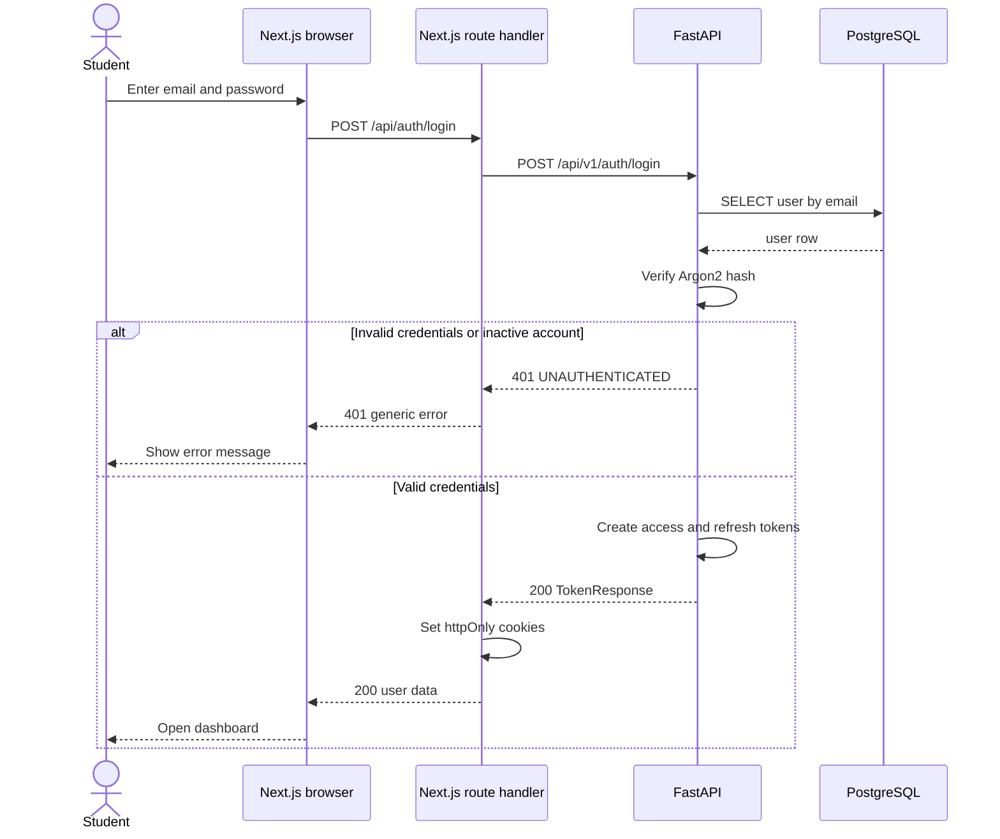
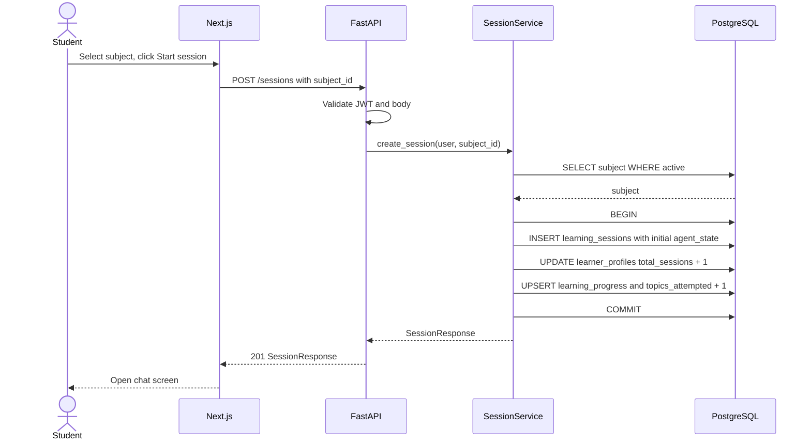
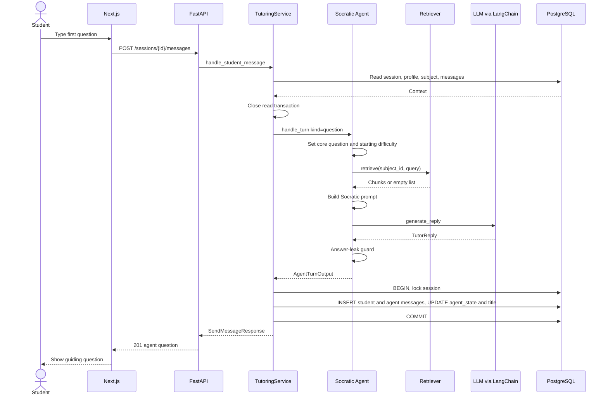
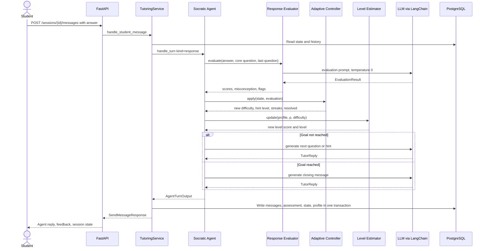
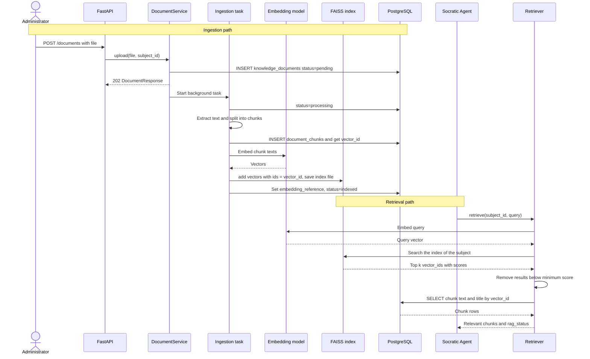
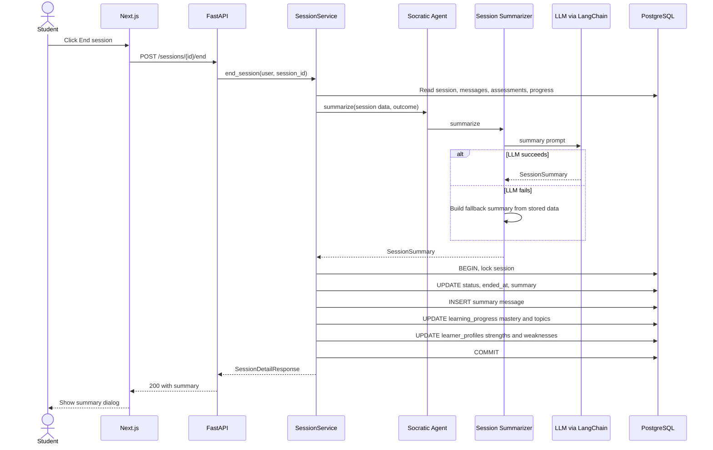

# Sequence Diagrams and Example Learning Session

*Socratic Agent project document. [Index](README.md) | [← Previous](11-frontend-and-ui.md) | [Next →](13-testing-and-ai-evaluation.md)*

---

## 22. Sequence Diagrams

### 22.1 User Login



### 22.2 Starting a Learning Session



### 22.3 Student Question and Socratic Response (First Turn)



### 22.4 Student Response Evaluation (Later Turns)



### 22.5 RAG Retrieval and Ingestion



### 22.6 Session Completion



---

## 23. Learning Session Workflow

### 23.1 Example Session

Subject: **Python Programming**. Student level: **beginner** (`level_score` 0.300, 0 assessments). RAG: off. Starting difficulty: 2.

```text
Student Question
→ Agent Question
→ Student Response
→ Evaluation
→ Hint
→ Student Response
→ Evaluation
→ Adaptive Guidance
→ Correct Reasoning
→ Summary
```

**Turn 0 - Student Question**

> **Student:** Why does `0.1 + 0.2 == 0.3` return `False` in Python?

The agent saves the core question and sets difficulty 2.

**Turn 0 - Agent Question** (`guidance`)

> **Agent:** Good question. Before we look at Python, think about a simpler number. Can you write 1/3 as an exact decimal?

**Turn 1 - Student Response**

> **Student:** 0.333 I guess? I do not see how this helps. Can I have a hint?

**Turn 1 - Evaluation**

| Field | Value |
|---|---|
| correctness / reasoning / confidence | 0.40 / 0.30 / 0.40 |
| misconception | "treats a rounded decimal as an exact value" |
| addresses_core_question | false |
| requests_hint | true |
| performance `p` | 0.55·0.40 + 0.45·0.30 = **0.355** (low) |
| state change | `low_streak` 1. Hint requested: `hint_level` 0 → 1, `hints_used` 1. Difficulty stays 2. |
| level estimate | `x` = 0.355 · 0.9 = 0.320. `S` = 0.8·0.300 + 0.2·0.320 = **0.304**. 1 assessment: no level change. |

**Turn 1 - Hint** (`hint`, level 1)

> **Agent:** Here is a nudge. Some fractions end as decimals in base 10, and some do not. Try 1/2, 1/4, 1/5 and 1/3. Which ones end? What do their denominators have in common?

**Turn 2 - Student Response**

> **Student:** 1/2, 1/4 and 1/5 end. 1/3 does not. The ones that end have denominators with only 2 or 5, and those are the factors of 10.

**Turn 2 - Evaluation**

| Field | Value |
|---|---|
| correctness / reasoning / confidence | 0.90 / 0.80 / 0.80 |
| misconception | none |
| addresses_core_question | false (correct, but only the base 10 part) |
| performance `p` | 0.55·0.90 + 0.45·0.80 = **0.855** (high) |
| state change | `high_streak` 1, `low_streak` 0, `stuck_turns` 0. `hint_level` 1 → 0. Difficulty stays 2 (needs two high turns). |
| level estimate | `x` = 0.855 · 0.9 = 0.770. `S` = 0.8·0.304 + 0.2·0.770 = **0.397**. 2 assessments. |

**Turn 2 - Adaptive Guidance** (`guidance`, mode `ask`, builds on the student's own rule)

> **Agent:** Nice rule, and you found it yourself. A computer stores numbers in base 2, not base 10. In base 10, the factors of 10 are 2 and 5. Using the same idea, which prime factors can the denominator have if a fraction must end in base 2? Then test 1/10.

**Turn 3 - Student Response**

> **Student:** Only 2. 1/10 has a 5 in its denominator, so it does not end in base 2. The computer must cut it off, so 0.1 + 0.2 is a tiny bit different from 0.3.

**Turn 3 - Evaluation (Correct Reasoning)**

| Field | Value |
|---|---|
| correctness / reasoning / confidence | 0.95 / 0.90 / 0.90 |
| addresses_core_question | **true** |
| performance `p` | 0.55·0.95 + 0.45·0.90 = **0.9275** (high) |
| resolution | c ≥ 0.85, r ≥ 0.75 and the core question is answered → `resolved = true` |
| level estimate | `x` = 0.9275 · 0.9 = 0.835. `S` = 0.8·0.397 + 0.2·0.835 = **0.485**. 3 assessments: no level change yet. |

**Turn 3 - Agent Closing** (`guidance`, mode `close`)

> **Agent:** Yes. You explained it in your own words: 1/10 does not end in base 2, so the computer rounds it. You can end the session now to see your summary.

**End Session - Summary** (`SessionSummary`)

| Field | Value |
|---|---|
| outcome | resolved |
| overview | You explained why `0.1 + 0.2` is not exactly `0.3`. You found a rule for which fractions end in a number base. |
| key_concepts | binary fractions, finite and repeating expansions, floating-point rounding |
| strengths | You found a general rule from examples. |
| misconceptions_addressed | treats a rounded decimal as an exact value |
| areas_to_review | comparing floating-point numbers with a tolerance |
| next_steps | Try `math.isclose()` on three examples. |

**Stored result**

| Table | Change |
|---|---|
| `messages` | 9 rows: 4 student (1 `question`, 3 `response`), 4 agent (`guidance`, `hint`, `guidance`, closing `guidance`), 1 agent `summary`. |
| `learner_assessments` | 3 rows (turns 1, 2, 3). Turn 3 has `resolves_goal = true`. |
| `learning_sessions` | `status = completed`, `ended_at` set, `summary` set, `title` = first 60 characters of the question. |
| `learning_progress` | Session score = mean(0.355, 0.855, 0.9275) − 0.05 · 1 hint = 0.7125 − 0.05 = **0.6625**. First completed session: `mastery_score` = 0.663. The score is below 0.75, so `topics_mastered` stays 0. `topics_attempted` is 1. |
| `learner_profiles` | `level_score` 0.485, `assessment_count` 3, level `beginner`. `strengths` gets "finite and repeating expansions". `weaknesses` stays unchanged: the misconception count in this session is 1 (less than 2). |

---

*[Index](README.md) | [← Previous](11-frontend-and-ui.md) | [Next →](13-testing-and-ai-evaluation.md)*
